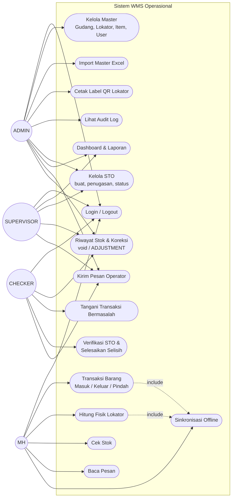
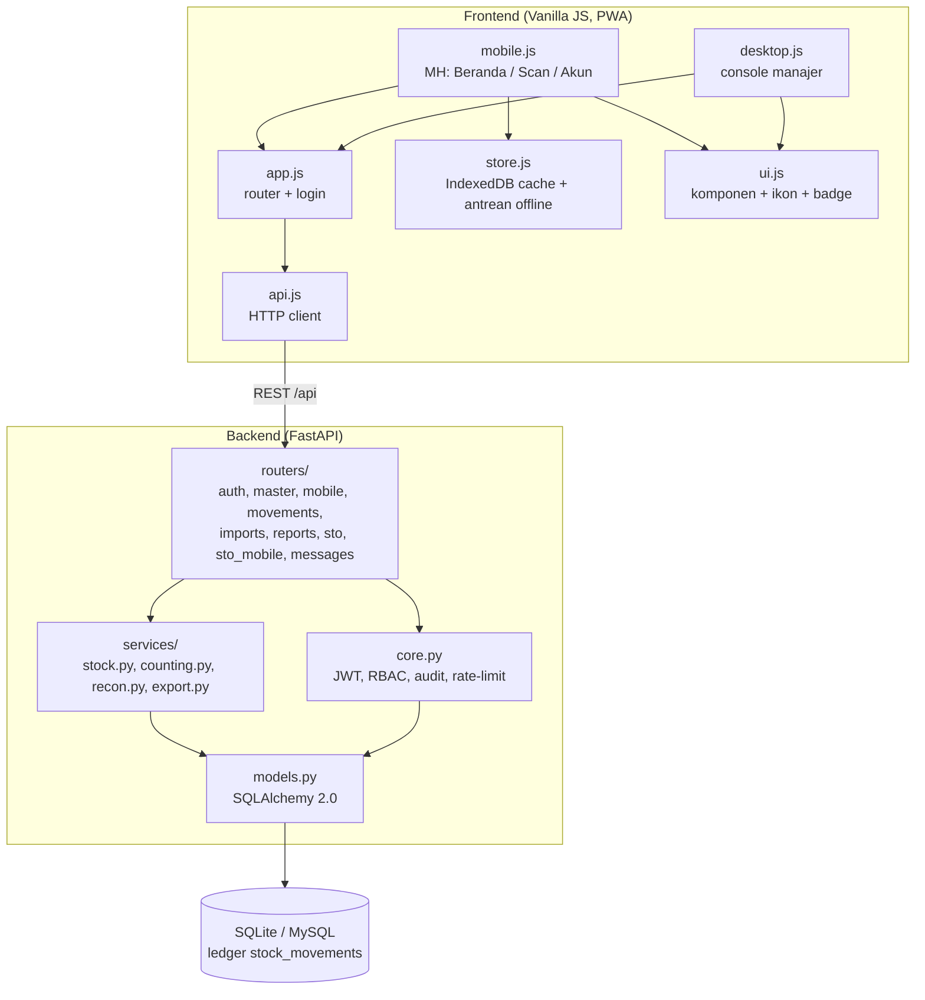
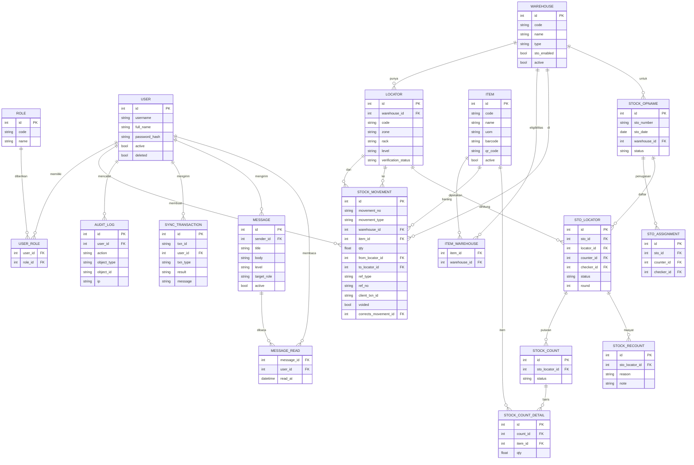
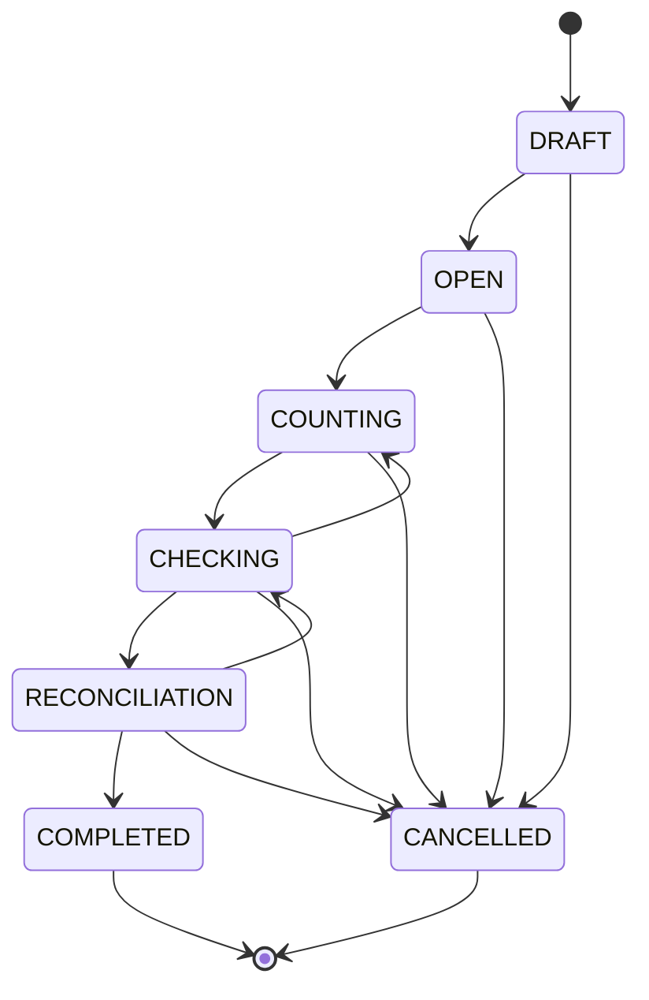
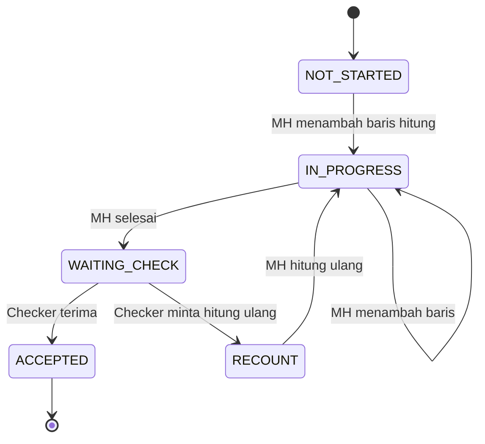
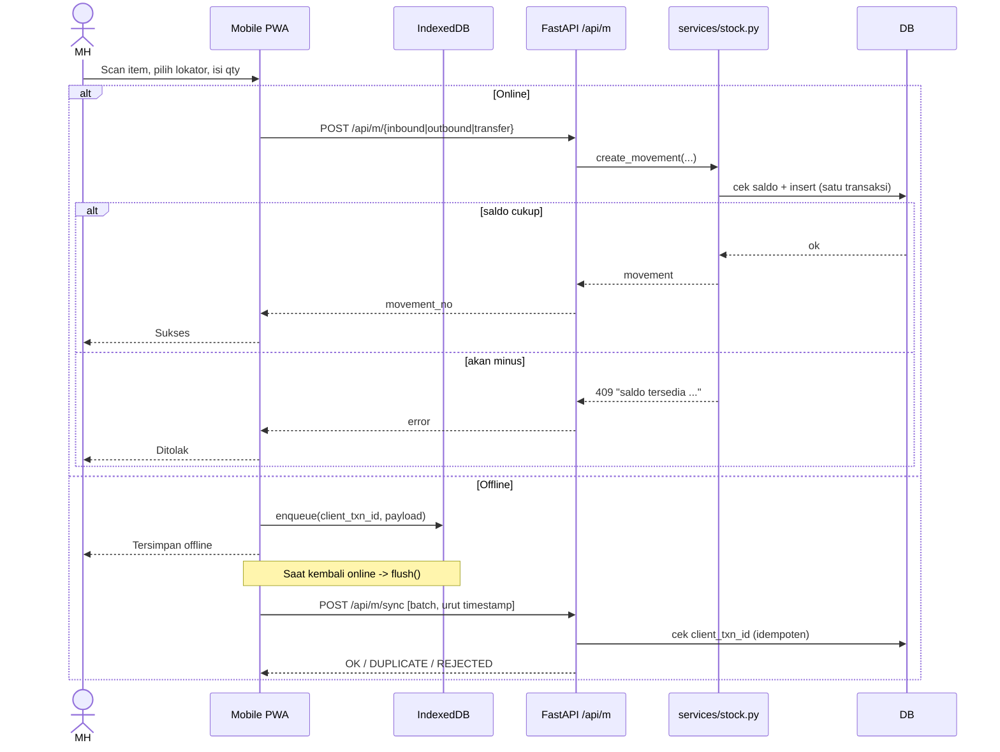
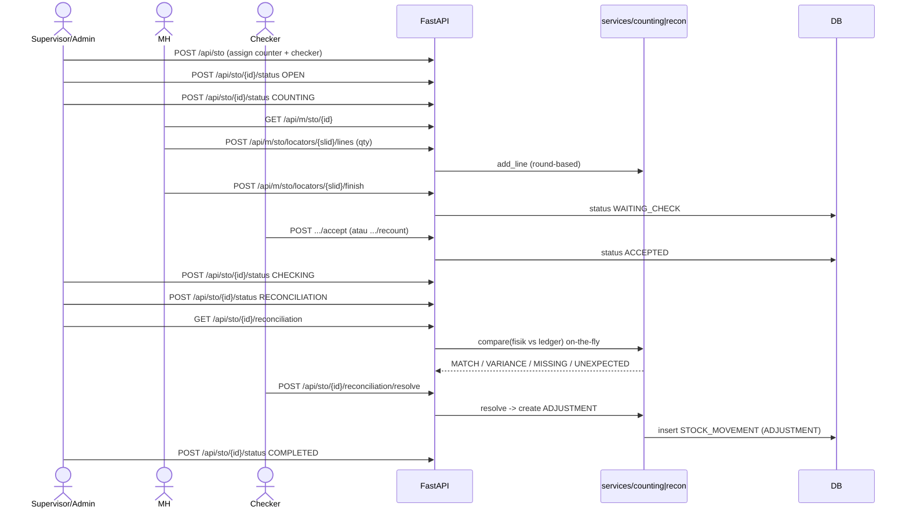
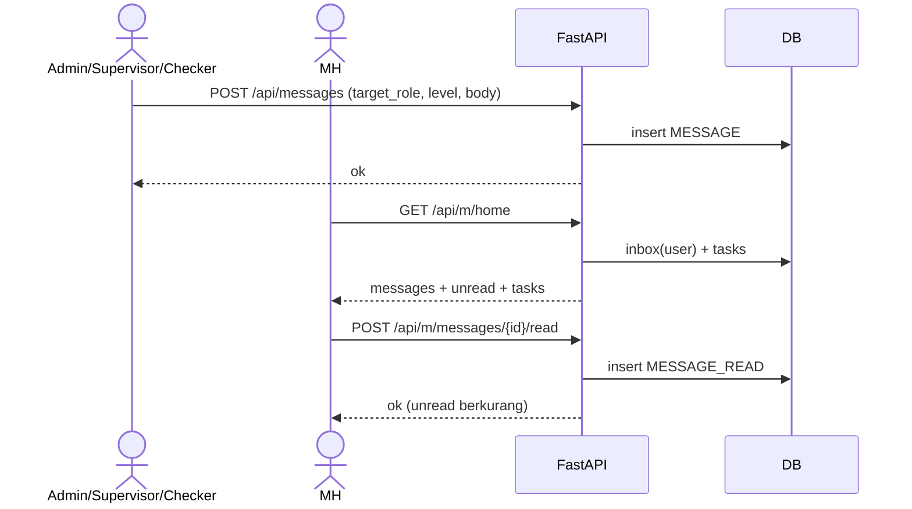
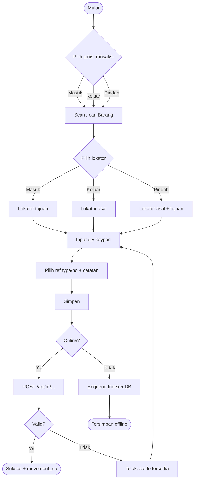
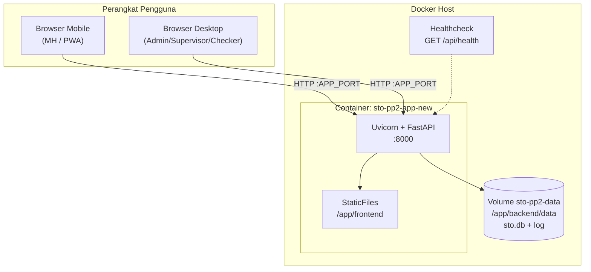

# Diagram Model — WMS Operasional (Fase 1 + Fase 2 + Fase 3)

> Pelengkap visual untuk `project.md` (SSOT). Semua diagram memakai **Mermaid**.
> Cara render: GitHub (otomatis), VS Code (ekstensi *Markdown Preview Mermaid Support*), Obsidian, atau tempel blok ke https://mermaid.live.

Daftar diagram:
1. [Use Case](#1-use-case-diagram)
2. [Arsitektur / Komponen](#2-arsitektur--komponen)
3. [ERD / Data Model](#3-erd--data-model)
4. [State Diagram — STO & StoLocator](#4-state-diagram--sto--stolocator)
5. [Sequence — Transaksi Barang (offline-first)](#5-sequence--transaksi-barang-offline-first)
6. [Sequence — Stock Opname end-to-end](#6-sequence--stock-opname-end-to-end)
7. [Sequence — Pesan Operator](#7-sequence--pesan-operator)
8. [Activity — Alur Scan MH terpadu](#8-activity--alur-scan-mh-terpadu)
9. [Activity — Sinkronisasi Offline](#9-activity--sinkronisasi-offline)
10. [Deployment (Docker)](#10-deployment-docker)

---

## 1. Use Case Diagram



---

## 2. Arsitektur / Komponen



---

## 3. ERD / Data Model



> Catatan: `STOCK_MOVEMENT` adalah **ledger** (append-only). Saldo = `SUM(masuk) − SUM(keluar)` di luar baris `voided`. Rekonsiliasi STO **tidak** disimpan sebagai tabel — dihitung *on-the-fly* dari ledger + hasil `STOCK_COUNT_DETAIL`.

---

## 4. State Diagram — STO & StoLocator

**Status Stock Opname (`STO_TRANSITIONS`):**



> Gate `RECONCILIATION`/`COMPLETED`: semua lokator `ACCEPTED` dan `issues == 0` (kecuali `force`).

**Status Lokator (`StoLocator`):**



---

## 5. Sequence — Transaksi Barang (offline-first)



---

## 6. Sequence — Stock Opname end-to-end



---

## 7. Sequence — Pesan Operator



---

## 8. Activity — Alur Scan MH terpadu



---

## 9. Activity — Sinkronisasi Offline

```mermaid
flowchart TD
  start([flush]) --> loop{Ada antrean?}
  loop -->|Tidak| end([Selesai])
  loop -->|Ya| send[POST /api/m/sync atau /api/m/sto/sync]
  send --> res{Hasil per txn}
  res -->|OK| del[Hapus dari antrean]
  res -->|DUPLICATE| del
  res -->|REJECTED| keep[Tandai ditolak + pesan]
  del --> loop
  keep --> loop
  end --> retry{Ada yang ditolak?}
  retry -->|Ya| menu([Retry / Discard oleh MH])
  retry -->|Tidak| selesai([Selesai])
```

---

## 10. Deployment (Docker)


